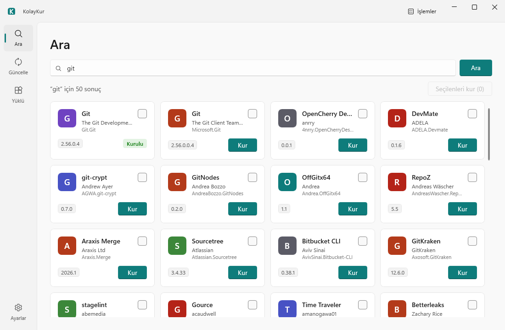
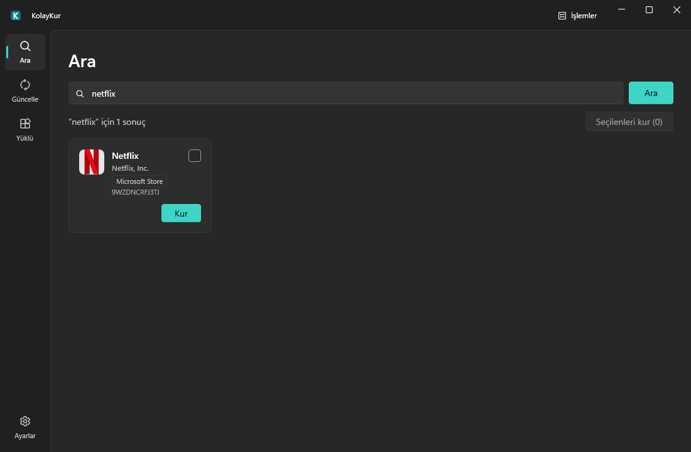
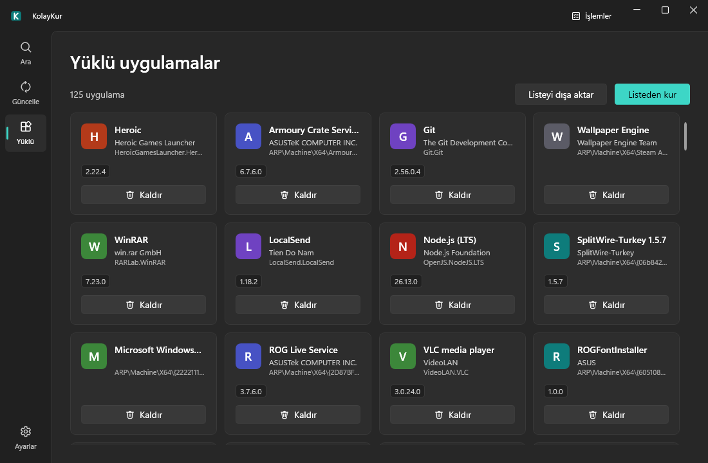
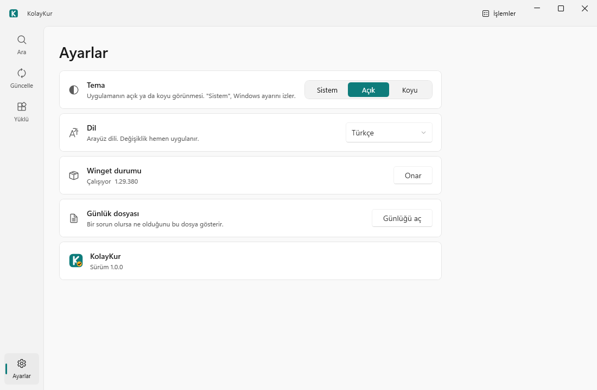

# KolayKur — Windows için tek tıkla uygulama kurucu

**Ara · Kur · Güncelle · Kaldır.**

KolayKur, Windows'un paket yöneticisi winget'i ve Microsoft Store'u terminal açmadan kullandıran küçük bir programdır. Uygulama arar, kurar, günceller ve kaldırır; hepsi pencereden yapılır, komut yazmak gerekmez. Tek bir `KolayKur.exe` dosyasıdır, ek kurulum istemez. Türkçe ve İngilizce arayüzü, açık ve koyu teması vardır.









## İndir

**[KolayKur.exe dosyasını indir](https://github.com/burakkayadev/KolayKur/releases/latest)**: en son sürümün sayfasından `KolayKur.exe` dosyasını indirin. Kurulum gerekmez; masaüstü gibi yazılabilir bir klasöre koyup çift tıklayın. .NET çalışma ortamı exe'nin içine gömülüdür, ayrıca .NET kurmanız gerekmez.

## Kullanım

- **Windows uyarısı (SmartScreen):** program **imzasızdır** (kod imzalama sertifikası yoktur), bu yüzden ilk açılışta "Windows bilgisayarınızı korudu" uyarısı çıkabilir. **Ek bilgi** bağlantısına, ardından **Yine de çalıştır** düğmesine basın. Kaynak kodu bu depodadır; isterseniz kendiniz derleyebilirsiniz.
- **Yazılabilir klasör:** program ilk açılışta çalışması için gereken küçük bir dosyayı (`Microsoft.Management.Deployment.winmd`, yaklaşık 64 KB) `KolayKur.exe`'nin yanına çıkarır. Klasör yazılamıyorsa program bunu söyler; exe'yi başka bir klasöre taşımanız yeterlidir.
- **Winget onarımı:** winget yoksa veya bozuksa program bunu algılar ve kurmayı ya da onarmayı önerir (Ayarlar sayfasındaki "Onar" düğmesiyle de açılır).
- **İzinler:** program normal kullanıcı olarak çalışır. Bir uygulamanın kurulumu yönetici izni isterse Windows'un kendi izin penceresi (UAC) çıkar; "Hayır" derseniz yalnızca o iş iptal olur, sıradaki işler devam eder.
- **Gizlilik (simgeler):** KolayKur uygulama simgelerini winget kataloğunda verilen adreslerden ve uygulamanın ya da yayıncının kendi sitesinden indirir; bu siteler bağlantınızı görür. Hiçbir aracı servis kullanılmaz. Simgeler `%LocalAppData%\KolayKur\icons` klasöründe saklanır (en çok 50 MB). Simge bulunamazsa ya da internet yoksa kartta uygulamanın ilk harfi görünür.

## Özellikler

| Özellik | Ne yapar |
| --- | --- |
| Ara | winget ve Microsoft Store uygulamalarını arar (örneğin Netflix), tek tıkla veya birkaçını seçip toplu kurar. Ücretli Store uygulamaları kurulamaz. Kartlarda uygulama simgeleri görünür. |
| Güncellemeler | Güncellemeleri listeler; tek tek veya hepsini birden günceller. |
| Yüklü uygulamalar | Yüklü uygulamaları listeler, kaldırmadan önce onay sorar; listeyi dosyaya kaydeder ve o listeden kurar. |
| İşlemler paneli | Sıradaki ve biten işleri, ilerlemeyi ve başarısız işlerin nedenini gösterir. |
| Ayarlar | Açık, koyu veya Windows'a uyan tema; Türkçe ve İngilizce arayüz; günlük dosyasını açma; sürüm bilgisi. |
| Winget onarımı | Winget yoksa veya bozuksa teşhis edip kurar ve onarır. |

## Gereksinimler

- 64 bit (x64) Windows 11. ARM işlemcili bilgisayarlar kapsam dışıdır.
- Windows 10'da çalışması beklenir, ama **denenmedi**.
- Winget. Yoksa veya bozuksa program bunu algılar ve onarmayı önerir.

## Dosyalar nerede

Ayarlar ve günlük dosyaları `%LocalAppData%\KolayKur` klasöründedir (yani `C:\Users\<ad>\AppData\Local\KolayKur`). Uygulama simgeleri `%LocalAppData%\KolayKur\icons` klasöründe önbelleğe alınır. Günlüğü Ayarlar sayfasındaki "Günlüğü aç" düğmesiyle de açabilirsiniz. Winget onarımı sırasında indirilen dosyalar `%LocalAppData%\KolayKur\downloads` klasörüne gider ve onarım başarılı olunca silinir.

Programın kendisi iki yere daha dosya bırakır:

- `Microsoft.Management.Deployment.winmd`: ilk açılışta `KolayKur.exe`'nin **yanına** çıkarılır (bkz. Kullanım).
- .NET tek dosya çıkarma klasörü: `%TEMP%\.net\KolayKur`. Tek dosyalık program, içine gömülü bazı dosyaları ilk çalışmada buraya açar. Silmek güvenlidir, program gerekirse yeniden oluşturur.

## Denenenler ve denenmeyenler

Dürüst durum notu:

| Konu | Durum |
| --- | --- |
| Otomatik testler (sahte winget ile) | Geçiyor (425 test) |
| Yeni görünüm (açık/koyu tema, yeni ikon) | Otomatik testler ve ekran görüntüleriyle kapsandı; proje sahibinin son elle kontrolü bekliyor |
| Tek `KolayKur.exe`'nin boş bir klasörde tek başına açılması | Denendi |
| Programın ürettiği liste dosyasının `winget import` ile okunması | Denendi (biçim hatası yok) |
| Programdan gerçek kurma / güncelleme / kaldırma | Denendi (proje sahibi, 8 Kasım 2026) |
| UAC izin penceresi ve "Hayır" yolu | Denendi |
| İngilizce arayüz | Denendi |
| Listeyi dışa aktarma | Denendi |
| Windows Sandbox'ta (winget ve .NET yokken) açılış, winget kurulumu ve arama | Denendi |
| Toplu kurma ve listeden kurma | Yalnızca otomatik testlerde sınandı |
| Kurulu ama bozuk bir winget'in gerçek bir makinede onarılması | Henüz denenmedi |
| Store'dan gerçek kurulum | Henüz denenmedi |
| Windows 10 | Henüz denenmedi |
| Arkadaşların GitHub'dan indirip SmartScreen uyarısını geçmesi | Henüz denenmedi |

## Derleme ve sınama

Gereken: .NET 10 SDK.

Tek dosya yayını:

```bash
dotnet publish src/KolayKur.App -c Release -r win-x64 --self-contained true -p:PublishSingleFile=true -p:IncludeNativeLibrariesForSelfExtract=true -o out/release
```

Sonuç `out/release/KolayKur.exe` dosyasıdır; dağıtılacak tek dosya budur (klasördeki `.pdb` dosyaları hata ayıklama içindir). Sıkıştırma (`EnableCompressionInSingleFile`) uygulama projesinde açıktır: dosya yaklaşık 71 MB olur (ölçülen: 74.478.649 bayt). Sıkıştırmasız üretmek isterseniz komuta `-p:EnableCompressionInSingleFile=false` ekleyin.

Testler:

```bash
dotnet test --filter "Category!=Real"
```

`Category=Real` testleri gerçek winget'e bağlanır. Bunlardan yalnızca bir tanesi makineye bir şey kurar ve kaldırır; o test yalnızca `KOLAYKUR_REAL_INSTALL=1` ortam değişkeni verilirse çalışır. Bu değişkeni yalnızca yazılımın kurulup kaldırılmasını göze alıyorsanız verin.

## Lisans

KolayKur [MIT lisansı](LICENSE) ile dağıtılır. Kullanılan üçüncü taraf bileşenler ve lisansları [THIRD-PARTY-NOTICES.md](THIRD-PARTY-NOTICES.md) dosyasındadır.

**Lisans ve koşullar notu:** "Kur" düğmesine basmak, o uygulamanın lisansını kabul etmek anlamına gelir. KolayKur ayrıca arama ve kurulum için Microsoft Store'u da kullanır ve Microsoft Store kullanım koşullarını sizin adınıza kabul eder. Program bunu ilk açılışta ve koşullar değiştiğinde, Store'a bağlanmadan önce hatırlatır.

---

**Burak** ([@burakkayadev](https://github.com/burakkayadev)) · İsterseniz bir kahve: [buymeacoffee.com/burakkayadev](https://buymeacoffee.com/burakkayadev)

---

# English

**Search · Install · Update · Uninstall.**

KolayKur is a small Windows program that lets you use winget (the Windows package manager) and the Microsoft Store without opening a terminal. You can search, install, update and uninstall apps from a window. It is a single `KolayKur.exe` with no installation step, a Turkish and English interface, and light and dark themes.

**Download:** get `KolayKur.exe` from the [latest release](https://github.com/burakkayadev/KolayKur/releases/latest) and run it from a writable folder such as the Desktop. .NET is bundled inside, so you do not need to install it. On first start the program extracts a small file (`Microsoft.Management.Deployment.winmd`, about 64 KB) next to the exe; if the folder is not writable it tells you to move the exe.

**SmartScreen:** the program is **unsigned**, so Windows may show "Windows protected your PC". Click **More info**, then **Run anyway**.

**Features:** search winget and Microsoft Store apps (paid Store apps cannot be installed) with app icons on the cards, one-click and multi-select install; list updates and update one or all; list and uninstall installed apps (asks first); export your app list to a file and install from a list; an operations panel with progress and failure reasons; theme (light, dark or follow Windows) and language settings; diagnoses and installs or repairs a missing or broken winget.

**Requirements:** 64-bit Windows 11. Windows 10 is expected to work but has not been tested. ARM is out of scope.

**Administrator rights:** the program runs as a normal user. If an installer needs admin rights, Windows shows its own UAC prompt; answering "No" cancels only that job and the queue continues.

**Privacy (icons):** KolayKur downloads app icons from the addresses given in the winget catalog and from the app's or publisher's own website; those sites see your connection. No third-party icon service is used. Icons are stored in `%LocalAppData%\KolayKur\icons` (50 MB at most). If no icon is found, or you are offline, the card shows the app's first letter.

**Files:** settings and logs are in `%LocalAppData%\KolayKur`; app icons are cached in `%LocalAppData%\KolayKur\icons`; files downloaded during a winget repair go to `%LocalAppData%\KolayKur\downloads` and are deleted after a successful repair. The program also leaves the `Microsoft.Management.Deployment.winmd` file next to `KolayKur.exe` and the .NET single-file extraction folder `%TEMP%\.net\KolayKur` (safe to delete).

**Status:** install, update, uninstall, the UAC "No" path, the English UI and export were tried with the real winget on the owner's PC and worked (8 November 2026); the missing-winget case was verified in Windows Sandbox. 425 automated tests (with a fake winget) pass. Batch install and install-from-list are covered by automated tests only. Not yet tested: real installs from the Microsoft Store, repairing an installed-but-broken winget on a real machine, Windows 10, and downloads by friends through GitHub Releases (SmartScreen).

**Build:** see the `dotnet publish` command above (about 71 MB output, measured 74,478,649 bytes). Run tests with `dotnet test --filter "Category!=Real"`. Tests marked `Real` use the real winget; the one that installs and uninstalls software only runs when `KOLAYKUR_REAL_INSTALL=1` is set.

**License:** [MIT](LICENSE); third-party components are listed in [THIRD-PARTY-NOTICES.md](THIRD-PARTY-NOTICES.md). Pressing "Install" (Kur) means you accept that app's license. KolayKur also uses the Microsoft Store for searching and installing, and accepts the Microsoft Store terms on your behalf. The program shows this notice at first use and again when the terms change.

**Burak** ([@burakkayadev](https://github.com/burakkayadev)) · Buy me a coffee: [buymeacoffee.com/burakkayadev](https://buymeacoffee.com/burakkayadev)
